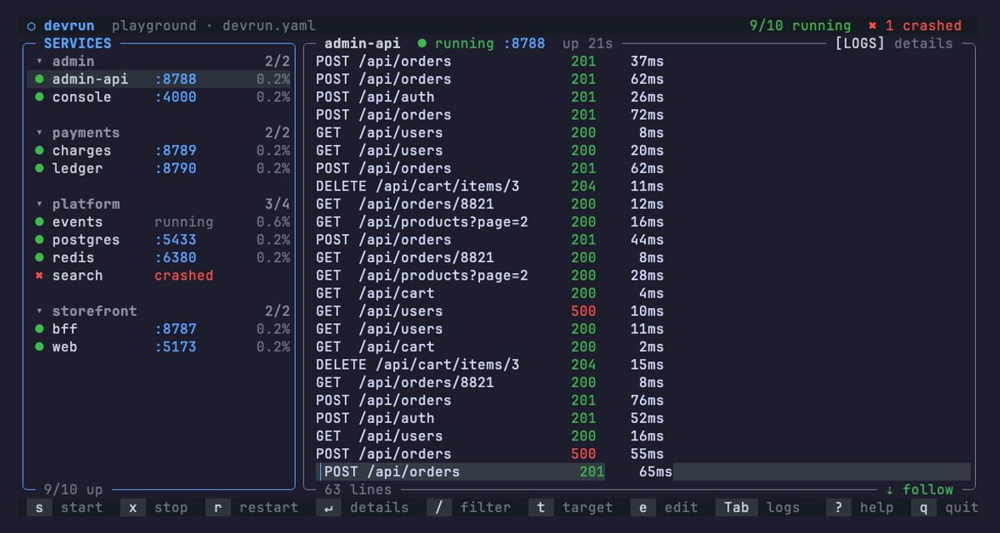

<div align="center">

# ⬡ devrun

**One place for every service you run while you work.**

[](https://github.com/hailerity/devrun/releases)
[](https://github.com/hailerity/devrun/actions/workflows/ci.yml)
[](https://goreportcard.com/report/github.com/hailerity/devrun)
[](https://go.dev)
[](LICENSE)


[Install](#install) · [Quickstart](#quickstart) · [Dashboard](docs/dashboard.md) · [Config](docs/configuration.md) · [AI agents](docs/agents.md) · [Gateway](docs/gateway.md)

</div>

---

Your app is ten processes across four sub-projects — and it is not the only thing you are working on today. Right now each one owns a terminal tab, and you remember which is which by the order you opened them. Something crashed twenty minutes ago and you have not noticed.

`devrun` holds them instead. Register a command once, start it by name, and watch everything from one dashboard — with logs that survive closing the terminal, because the processes do too.

Written in Go, ships as one binary, and depends on nothing at runtime.

```sh
devrun add shop-web "yarn dev"     --cwd ~/work/shop --group shop
devrun add blog     "hugo serve"   --cwd ~/work/blog --group blog
devrun start --all
devrun                  # one dashboard, sectioned by project
```

## Why devrun

- **One binary, any language.** Not Node-only, not a Procfile, not containers. If a shell can run it, devrun can hold it.
- **It outlives your terminal.** A daemon owns the processes. Close the window, reboot the shell, reattach — they are still there, still logging.
- **Commit `devrun.yaml`.** Someone clones the repo and types `devrun up`. That is the onboarding doc.
- **See the whole system at once.** States, ports, CPU, memory, uptime and live logs in one TUI, sectioned by group and foldable when the list gets long.
- **Share what you're running.** One local address for every service, and optionally a Cloudflare tunnel over it, so the designer on your team can look at your branch.
- **Your coding agent can drive it.** Claude Code and Codex start services through devrun instead of blocking on `npm run dev` — and what they start shows up in *your* dashboard.

## Install

**macOS / Linux**

```sh
curl -fsSL https://raw.githubusercontent.com/hailerity/devrun/main/scripts/install.sh | sh
```

Installs to `/usr/local/bin`, or `~/.local/bin` without sudo. Pin a version with `DEVRUN_VERSION=v0.4.0`, change the destination with `DEVRUN_INSTALL`.

**Go** — requires Go 1.26+

```sh
go install github.com/hailerity/devrun/cmd/devrun@latest
```

**From source**

```sh
git clone https://github.com/hailerity/devrun && cd devrun && make install
```

Then `devrun --version`. Prebuilt binaries for linux/darwin × amd64/arm64 are on the [releases page](https://github.com/hailerity/devrun/releases) with sha256 checksums.

## Quickstart

### A project you can commit

```yaml
# devrun.yaml — a monorepo with four sub-projects in it
name: acme

services:
  web:        { command: yarn dev,              cwd: ./storefront, group: storefront }
  bff:        { command: go run ./cmd/bff,      group: storefront }

  console:    { command: yarn dev,              cwd: ./admin,      group: admin }
  admin-api:  { command: go run ./cmd/admin,    group: admin }

  charges:    { command: go run ./cmd/payments, group: payments }
  ledger:     { command: go run ./cmd/ledger,   group: payments }

  postgres:   { command: postgres -D ./pgdata,  group: platform }
  redis:      { command: redis-server,          group: platform }
  mailpit:    { command: mailpit,               group: platform }
  search:     { command: go run ./cmd/search,   group: platform }

# A service can be in as many targets as you like — postgres is in three, so
# `devrun target stop admin` leaves it running while storefront still holds it.
targets:
  storefront: [web, bff, postgres, redis]
  admin:      [console, admin-api, postgres]
  payments:   [charges, ledger, postgres]
```

```sh
devrun up                     # start all ten
devrun target start payments  # or just one team's
devrun                        # open the dashboard
devrun logs ledger -f         # follow one service
devrun down                   # stop them all
```

`group:` and `targets:` answer different questions. A **group** is where a service *lives* in the list — one each, so the sidebar sections and folds. A **target** is a set you *act on*, and a service can be in several. Omit `group:` and a service inherits the project's name, which is right for a repo that is one thing.

### Many repos, not one

The same works across projects. Services registered with `devrun add` live in your global registry, and devrun uses it in any directory with no `devrun.yaml`:

```sh
devrun add shop-web  "yarn dev"       --cwd ~/work/shop  --group shop
devrun add shop-api  "go run ./api"   --cwd ~/work/shop  --group shop
devrun add blog      "hugo serve"     --cwd ~/work/blog  --group blog
devrun add postgres  "postgres -D ~/pgdata"              --group infra

devrun start --all     # every project, one command
devrun                 # one dashboard, sectioned by project
```

A directory with a `devrun.yaml` uses that file; everywhere else the registry. `--global` forces the registry even inside a project.

## The dashboard



Ten services in four sub-projects, nine of them up. A group header carries its own running count, so `platform 3/4` says something in there is wrong before you unfold it — and `Space` folds a sub-project away when it is not what you are working on.

`s` start · `x` stop · `r` restart · `S`/`X` everything listed · `/` filter by name · `t` filter by target · `Space` fold a group · `e` edit · `d` remove · `↵` logs ⇄ details · `?` every key

The list is alphabetical and **stays put**, so nothing moves under your cursor. Logs search with `/`, select with `v`, copy with `y`. Colours adapt to light and dark terminals.

→ [Full dashboard reference](docs/dashboard.md)

## Commands

| | |
|---|---|
| `devrun` | Open the dashboard |
| `devrun up` / `down` | Start / stop everything in `devrun.yaml` |
| `devrun add <name> <cmd>` | Register a service — `--cwd`, `--group`, `--env K=V` |
| `devrun remove <name>` | Unregister it |
| `devrun list` | Every service in scope, with state |
| `devrun start <name>` / `--all` | Start one, or all — `--fg` attaches your terminal |
| `devrun stop <name>` / `--all` | Stop one, or all |
| `devrun logs <name>` | Last 100 lines — `-f` to follow, `-n` for more |
| `devrun fg <name>` | Attach to a running service (`Ctrl+P` `Q` detaches, `Ctrl+C` stops it) |
| `devrun info [name]` | Where everything lives, what is running, one service's detail |
| `devrun target …` | `create`, `add`, `rm`, `list`, `start`, `stop` — a named set of services |
| `devrun gateway …` | `up`, `down`, `status`, `expose`, `hide` |
| `devrun tunnel …` | `up`, `down`, `status` |
| `devrun daemon …` | `status`, `stop`, `restart` |
| `devrun mcp` | The MCP server — launched by your agent, not by you |

`--global` / `-g` works on all of them: act on the global registry even inside a project.

## Use it from your coding agent

Agents are bad at long-running processes: they block on a foreground dev server, or background it and lose the output, or leave it running after the session ends. `devrun mcp` gives them the daemon instead — so a service an agent starts appears in your dashboard, and one you started is one it can read the logs of.

```sh
claude plugin marketplace add hailerity/devrun
claude plugin install devrun@hailerity
```

The plugin brings the MCP server *and* a skill that tells the agent to reach for devrun, rather than leaving it to notice the tools. For Codex, or Claude Code without the plugin: `codex mcp add devrun -- devrun mcp` / `claude mcp add devrun -- devrun mcp`.

Eight tools: `list_services`, `service_status`, `logs` and `gateway_status` only read. `add_service`, `add_to_target`, `start` and `stop` write. `start` **waits for the outcome** — it comes back `running`, or `crashed` with the log lines that explain why, in the same call. Agents cannot remove or edit services, touch the daemon, or read the gateway token.

→ [Agent setup, permissions and every tool](docs/agents.md)

## Share what you're running

```sh
devrun gateway up            # http://localhost:7788/ — an index of everything running
devrun tunnel up web         # ...and put `web` on the internet, over Cloudflare
```

Each service gets its own origin (`web.localhost:7788`), so a frontend's relative `/api` calls keep working. Publishing is opt-in per service and gated by a token; the index is read-only — no start, no stop, no logs — because a leaked token should mean "someone saw my dev app", never remote process control. cloudflared is not a dependency: it is absent from `go.mod` and never looked for unless you publish.

→ [Gateway, postures, tokens and DNS](docs/gateway.md)

## How it compares

| | devrun | PM2 | Overmind / Foreman | tmux / zellij | Docker Compose |
|---|---|---|---|---|---|
| Any language | ✅ | Node-first | ✅ | ✅ | ✅ |
| Survives the terminal | ✅ | ✅ | — | ✅ | ✅ |
| Services registered by name, globally | ✅ | ✅ | Procfile only | — | per compose file |
| Live TUI with logs and stats | ✅ | `pm2 monit` | tmux panes | you build it | — |
| One address for everything | ✅ | — | — | — | via ports |
| Share over a tunnel | ✅ | — | — | — | — |
| MCP server for AI agents | ✅ | — | — | — | — |
| Needs containers | — | — | — | — | ✅ |

devrun is for your laptop while you are working on something. It is not a production supervisor, and does not try to be one.

## Documentation

| | |
|---|---|
| [The dashboard](docs/dashboard.md) | Every pane, every key, the group and filter model |
| [Configuration](docs/configuration.md) | `devrun.yaml`, the global registry, how scope is resolved, file locations |
| [AI agents](docs/agents.md) | MCP setup for Claude Code and Codex, the tools, permissions |
| [Gateway and publishing](docs/gateway.md) | One address for everything, tokens, Cloudflare tunnels, DNS |

## Contributing

```sh
make build        # bin/devrun
make test         # unit tests
make test-integration
make lint         # golangci-lint
```

Issues and pull requests welcome. CI runs on Linux and macOS against the Go version pinned in `go.mod`.

## License

[MIT](LICENSE) © Hai Le
